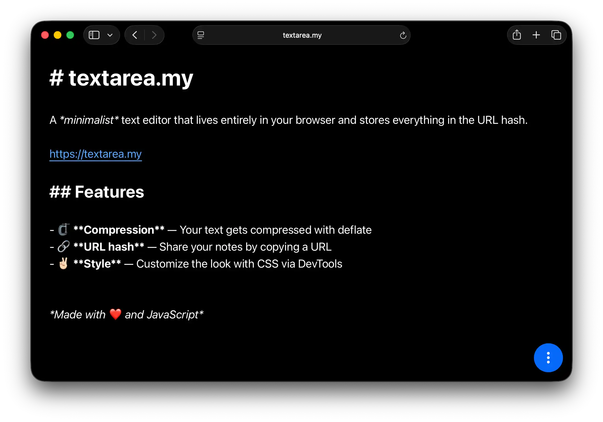

# Textarea

A _minimalist_ text editor that lives entirely in your browser.

Notes live in the URL, in your own document library, or in a file you export.
Nothing is uploaded, there is no account, and there is no server.

This is a fork of [antonmedv/textarea](https://github.com/antonmedv/textarea) by
Anton Medvedev, used under the MIT licence. Everything here that is not in that
project is listed under [Differences from upstream](#differences-from-upstream).

<p align="center">
  <a href="https://gitguy268-textarea.vercel.app/">
    
  </a>
</p>

**Live:** [gitguy268-textarea.vercel.app](https://gitguy268-textarea.vercel.app/)

## Features

- 🗜️ **Compression** – Your text gets compressed with deflate
- 🔗 **URL hash** – Share your notes by copying a URL
- 🗂️ **Document library** – Every note you write, kept in this browser, searchable
- 📁 **Folder sync** – Mirror every note into a folder you pick, and back, as markdown files
- 📤 **One-click export** – A file, the clipboard, a QR code, or an archive
- 📋 **Copy as** – The clipboard, in any of the nine export formats
- 🔳 **QR code** – Scan a note onto a phone, or save the symbol as SVG
- 🔒 **Encrypted links** – Protect a note with a password (AES-256-GCM)
- 📂 **Open files** – Text files, ZIP archives, and PDFs (with two-column detection)
- 💾 **Save as** – Plain text, Markdown, an HTML page, JSON, CSV, XML, RTF, LaTeX or YAML
- 🗜️ **ZIP export** – Any combination of the above in one archive, optionally AES-256 encrypted
- 📊 **Statistics** – Words, characters, lines, and how long it takes to read aloud
- 🌗 **Themes** – Follow the system, or choose light or dark
- 💧 **Liquid glass** – The menu, dialogs and statistics panel refract the page behind them, with a switch to turn it off
- ✉️ **Links** – Email addresses, `google:` searches and file paths become links, each behind its own switch
- 🏷️ **Wikilinks and backlinks** – `[[Link]]` to a note by title, and a panel listing the notes that link back
- ⌨️ **Quick switcher** – Cmd/Ctrl+K jumps to any note from a few typed letters
- ⚙️ **Settings** – Every switch and knob the app has, in one panel
- 🎨 **Appearance** – An accent colour, the note's font, its size and line spacing
- 🔤 **Custom fonts** – A TTF, OTF, WOFF or WOFF2 of your own, from a file or a GitHub link, for the note to wear
- ✍️ **Writing tools** – Improve, shorten, summarise, fix or make casual — five rewrites that run on your machine, on a model that ships with the app, over the whole note or just your selection
- 🔎 **Find and replace** – Ctrl/Cmd+F over the note: a live match count, match case, whole words, one replace or all of them
- 🗃️ **Backup** – One press puts the whole library into a single ZIP, in Folder sync's own file format
- 🗑️ **Trash** – A deleted note waits 30 days (7 or 90) where one click brings it back
- ☑️ **Tasks** – `- [ ]` becomes a clickable checkbox, and a panel gathers every open task in the library
- 📱 **Installable** – Works offline as a progressive web app, and handles file drops
- 💕 **Style** – Customize the look with CSS via DevTools

Nothing is uploaded anywhere. Files are read in the page, notes live in the URL
and in your browser's own storage — and, if you ask for it, in a folder you pick
on your own disk — and the libraries are cached locally. The font shelf asks
outward once, and only for what you point it at: its GitHub import reads a
single file from `raw.githubusercontent.com` — the only host the
Content-Security-Policy allows it, and only while its button is pressed — and
keeps the bytes in the browser with everything else. The writing tools have no
such exception at all: the model ships with the app, and the prompt — at most
24,000 characters of this note — is answered without a single request leaving
the page.

## Using it

Everything is in the menu behind the blue button, and the panel it opens is
where most of the work happens.

### Export

One entry, four ways out:

| Destination | What happens |
|---|---|
| **Save to a file** | Converts to one of the nine formats and downloads it |
| **Copy to the clipboard** | The same nine formats, on the clipboard, in one click |
| **QR code** | Draws the note's link as a symbol, and saves it as SVG |
| **ZIP archive** | Any combination of the formats, optionally AES-256 encrypted |

A file and a clipboard share one format list and go through one converter, so
what lands on the clipboard is byte for byte what a download would have written.
No new formats were added for any of this: the same nine the editor has always
existed.

The QR code carries the **link**, not the text. A symbol runs out of room at
about 2.3 kB, and a link is what the rest of the app is built around anyway. If
a note is too long to encode, the panel says so and still offers the link to
copy by hand. Encrypted notes get a warning that the password is not in the code.

### My documents

Every note you write is written to IndexedDB about half a second after you stop
typing, and listed under **My documents**, newest first. Search covers titles and
bodies.

The panel is a board of cards rather than a list of rows, because what it is for
is recognising a note at a glance. Each note is a yellow square carrying its
title, the first couple of lines and the date it was last edited; the whole card
opens it, the corner button deletes it, and the card for the note on screen is
ringed and badged.

The library exists because the URL alone is a thin place to keep a note. The link
is the only copy until now, so a note is lost when the tab closes without the
link being kept, and a note large enough to hit the URL length limit has no link
at all. The library is the second copy.

It is not, by itself, a sync service. There is no network call anywhere in
`lib/library.js`, the database is per-origin, and clearing site data deletes it.
Mirroring it into a folder is a separate, opt-in feature — [Folder sync](#folder-sync)
below. The library holds one row
per note rather than one per keystroke: the row in hand is tracked in memory, and
only replaced when the address bar genuinely holds a different note. Two tabs
therefore stay separate rather than fighting over one row.

There is no rename control, on purpose. A note is named by its first `# heading`
everywhere else in the app — that is what names the tab and what the exported
file is called — so a second stored name could only ever disagree with the first.

If your browser refuses IndexedDB, which some private windows do, every library
function degrades to a no-op and the editor carries on. Losing the library is a
much smaller bug than refusing to accept text.

### Trash

Deleting a note from **My documents** sends it to the trash rather than away:
the note moves whole into a second store of the same database, in one
transaction over both, and the bubble says where it went. The **Trash** row in
the menu lists what was deleted, newest first, each card showing when it went;
one click puts a note back exactly as it was — same id, same text, so links
and folder sync find the note they knew rather than a stranger wearing its
words — a corner button takes one for good behind a question that says so, and
**Empty** clears the rest.

A deleted note is kept for 30 days by default, 7 or 90 chosen in Settings,
and anything past its days is purged when the panel opens — the only place
the store is ever read. The switch ships on, because undoing an accidental
delete is the one mistake worth a second chance; switch it off and the row
leaves the menu at once and deletes are immediate again, with the
confirmation naming the true promise either way. Without IndexedDB the row
hides with the rest of the library's.

### Folder sync

**Folder sync** mirrors the library into a folder on your computer and back. It
is offered where the browser has the File System Access API — Chrome and Edge —
and the row is hidden where it does not. Pick a folder once from the menu and
every note becomes a markdown file whose front matter block carries what
markdown has no syntax for:

```markdown
---
id: 7f3c0000-0000-4000-8000-000000000000
created: 1770000000000
updated: 1770000600000
words: 42
style: "color: red"
---
# The note itself, exactly as stored
```

Every `.md` file in the folder takes part: dropping one in imports it, and a
file without a block gets the block written back with its id so the next rename
cannot orphan it. After that three rules run:

- **Newest wins.** Whoever changed last — the app, or any editor — is what the
  other side becomes, decided by the block's `updated` and the file's own
  modification time. The same text with a new timestamp is not a change, so a
  touch or a round trip through another editor writes nothing.
- **Deletions mirror.** Deleting a note deletes its file; deleting a file
  deletes its note. Files the app never wrote are only ever read or imported,
  never removed, and the first pass over a folder removes nothing at all — the
  manifest that remembers which file belongs to which note is what authorises a
  deletion, and it starts empty.
- **While the app is open.** A pass runs when you pause typing, when the window
  gains focus and when you come back to the tab. An edit made elsewhere while
  the app was closed arrives on the next focus, and if it wins the note on
  screen follows it with an undoable replace. There is no background service.

A folder is whatever else may have written to it, so a pass has budgets like
every other input this app reads: a file over **10 MB** is identified by its
first few bytes and then left completely alone — never read, written, renamed
or removed — and a pass stops before a folder with more than **1,000**
markdown files or **100 MB** of them in total. A file that sits out is
announced once, not on every pass.

The browser asks for the folder's permission once per session — Chrome shows a
one-click **Allow** — and the menu row reads **Folder sync: _name_** while it is
on. Clicking it again offers to stop, which leaves every file exactly where it
is.

The files are **plaintext markdown**. That is the whole point of a folder any
editor can open, and it means anything with access to the folder can read the
notes. Nothing is sent anywhere: the folder is as local as the browser's own
storage.

### Backup

**Backup** sits beside **My documents** and writes the whole library into a
single ZIP in one press. The click flushes the pending save first, so the note
on screen is in the archive as it stands, and the entries are the same
front-mattered markdown files Folder sync writes — unzip the archive, point
Folder sync at the folder, and every note comes back with its id, timestamps
and style intact. That is what makes it a backup rather than a second export
format: the copy to take before a browser profile goes away.

The flow is all or nothing — a refused storage or an empty library says so
plainly instead of leaving half an archive. **Include note metadata** ships
on, since the front matter is what makes the archive restorable, and
**Encrypt with a password** ships off; both live in Settings, the password is
the export panel's dialog asked twice, and the module itself is fetched on
the click, so a reader who never backs up never pays for the code that writes
one.

### Statistics

**Statistics** puts a readout in the bottom left corner that follows the note as
you type: words, characters, characters without spaces, lines, sentences, and
two reading estimates.

The two rates are averages, not measurements, and the panel says so:

- **Spoken aloud** — 130 words a minute. Measured presentation pace is around
  140–150, but nobody reads a note aloud at a keynote.
- **Reading** — 220 words a minute. [Brysbaert (2019)](https://www.sciencedirect.com/science/article/pii/S0749598118301177)
  puts English non-fiction prose at 238 wpm, but that is young adults reading on a
  screen with nothing else to do.

Both are exported from `lib/stats.js`, so anyone who disagrees with the number can
read the arithmetic rather than a bare figure. The panel is deliberately *not* a
live region: a screen reader would announce the new count of every keystroke.

Japanese, Chinese and Korean text is counted a character at a time, because
splitting on whitespace would call half a page of prose a single word.

### Encryption

One **Encryption** entry, offering both sides of the same switch:

- **Encrypted link** — the note is encrypted with AES-256-GCM using a key derived
  with PBKDF2-HMAC-SHA256, and the address bar holds only ciphertext. Editing
  stops rewriting the URL, so the link stays exactly what you shared; the
  document library keeps its own plaintext copy, so the backup is not lost.
- **Remove encryption** – puts the note back in the URL in the clear.

The password is never stored. Anyone with both the link and the password can read
the note, and a lost password cannot be recovered.

### Writing tools

The **Writing tools** row in the menu opens a side panel with five one-press
tools — improve wording, shorten, summarise, fix grammar, make it more casual —
and one line of your own instructions that rides along with every one of them
("keep it short", "use British English"). Each tool has its own switch in
Settings, and the sentence is written there too.

The answer appears in the panel for reading, and replaces the note only when
you press **Replace**; undo takes it back. It runs entirely on your machine:
the engine is a vendored build of llama.cpp, and the model — Gemma 3, 270
million parameters — is part of this repository in four chunks, each verified
against a pinned checksum before anything loads. The first **Run** pulls those
chunks from this deployment (about 241 MB, then cached — offline after that);
everything before that first press fetches nothing at all. A note longer than
24,000 characters is cut in plain sight and the panel says so, because a
silent cut is the tool lying about what it worked on.

### Find and replace

Ctrl/Cmd+F opens the app's own find bar over the note: a query with a live
count of the matches, previous and next walking from either end with
wraparound, and a replace field with **Replace** and **Replace all** — the
second saying how many it changed. Enter finds the next match, Shift+Enter
the previous, Escape closes, and the bar's help line says the same.

Match case and whole words are checkboxes whose defaults live in Settings,
so an open bar and the Settings row always agree. The query is matched
literally rather than as a pattern, matches never overlap, and a replacement
that matches the query itself is pasted once and passed over — which is what
keeps **Replace all** finite. Every edit goes through the editor: one undo
takes a single replace back, one undo takes the whole batch.

The chord is the app's while **Find and replace** is switched on in Settings,
as it ships; switch it off and Ctrl+F is the browser's again, unclaimed —
Shift and Alt belong to its variants either way. The bar is fetched on the
first press, not at boot.

## Opening files

**Text** is decoded as UTF-8, with a byte order mark honoured when there is one.
A file that is not valid UTF-8 is read as Windows-1252, which is what Windows
tools usually write, and you are told when that happens rather than being handed
a wall of replacement characters.

**PDFs** are read with [pdf.js](https://mozilla.github.io/pdf.js/), which is
loaded only when you open one. A PDF stores glyph positions rather than lines and
paragraphs, so the structure is rebuilt from the geometry: runs are grouped by
baseline, word breaks come from horizontal gaps, and paragraph breaks from
vertical ones. That is enough to keep tables legible as text.

Two-column pages are detected by looking for a vertical gutter that no run crosses,
and are then read left column before right. It is on by default and can be turned
off from the menu; the choice is remembered. Detection is deliberately cautious,
because a single-column page with a wide margin, a figure or a centred title is
easy to mistake for two columns.

A PDF with no text layer (a scan, or a pure image) says so instead of opening an
empty note. A PDF that asks for a password prompts for it.

**ZIP archives** are read with [zip.js](https://gildas-lormeau.github.io/zip.js/),
also loaded on demand. An encrypted archive prompts once for the whole archive.
When it holds several files they are concatenated with a `# filename` heading
above each, since the editor holds one note.

Drag a file onto the editor, or drop it anywhere on the page, to open it.

## Saving

A single format downloads through the File System Access API where the browser
offers it, so you choose where it goes. Everywhere else it falls back to a normal
download. The file name comes from the document title.

**ZIP** is WinZip AES in AE-2 format with AES-256, which 7-Zip, Keka, WinZip and
Windows all open.

Two things about ZIP are worth knowing, because they are properties of the format
rather than choices made here:

- Entry names are stored outside the encrypted stream, so an encrypted archive
  still shows what it contains. Only the contents are encrypted.
- There is no way to recover a lost password.

## Markdown

The editor highlights a useful subset of Markdown as you type: headings, `**bold**`,
`*italic*`, `~~strike~~`, `` `code` ``, fenced code blocks, bare URLs, and bulleted
and numbered lists that nest by indentation.

The markers stay in the text and the decoration comes from CSS, so the note in the
URL is exactly what you typed. A `* ` becomes a drawn bullet while the characters
remain underneath it. For the same reason a numbered item keeps the number you
wrote rather than being renumbered, and a fence has to close to count.

`[[Another note's title]]` becomes a link to that note once **wikilinks** are
switched on in Settings — off by default, so a note written before that switch
renders exactly as it always did. Clicking one opens the note, or creates it
when the title names nothing yet; which of the two happens is its own switch.

A line beginning `- [ ]` or `- [x]` draws its brackets as a checkbox once
**Tasks** is switched on in Settings — off by default — and a click on the box
writes the one character that ticks it through the editor, so one undo takes
it back like any other keystroke. The characters themselves never leave the
text: copy the line, switch the feature off, and the brackets are exactly
where they were.

## Themes

The editor follows your system setting, as it always has. The menu can override
that with a light or dark theme, and the choice lives in the query string
(`?theme=dark`) rather than in storage, so a link carries it and nothing is
remembered behind your back. Back on "system" the parameter goes away again.

The accent colour, the note's font, its size and its line spacing live in
**Settings** rather than here: four remembered choices, applied as CSS custom
properties, so one accent carries through the menu, the panels and the note.
The same panel carries the **Custom fonts** shelf: a TTF, OTF, WOFF or WOFF2 —
the four formats every browser can load — from a file on your disk or from a
link to one in a public GitHub repository, offered in the note font list beside
the built-ins. It holds ten fonts of five megabytes each; a file is sniffed and
then judged by the browser itself before it is stored, so a corrupt or renamed
one is refused with a message instead of kept, and switching the shelf off puts
a note that was wearing one back on a system stack without deleting anything.

## Keyboard

| | |
|---|---|
| <kbd>Cmd/Ctrl</kbd> + <kbd>S</kbd> | Open the Export panel |
| <kbd>Cmd/Ctrl</kbd> + <kbd>O</kbd> | Open a file |
| <kbd>Cmd/Ctrl</kbd> + <kbd>K</kbd> | Open the quick switcher (P or E are the alternative chords) |
| <kbd>Cmd/Ctrl</kbd> + <kbd>F</kbd> | Find and replace in the note, while its switch is on |
| <kbd>Cmd/Ctrl</kbd> + <kbd>Z</kbd> | Undo, and <kbd>Shift</kbd> to redo |
| <kbd>↑</kbd> <kbd>↓</kbd> | Walk the menu once it is open |
| <kbd>Esc</kbd> | Close the menu or any panel |

## Pro tips

- Start your document with `# Title` to set a custom page title, which is also
  the name of the exported file and the row in the library.
- Indent a bullet by two spaces to nest it.
- Add a `style` attribute to the `<article>` tag via DevTools. It'll be saved in
  the URL too! Shared links keep only a safe subset of properties — colours,
  fonts, spacing — and drop anything that could cover the page or load a
  resource.
- Open several files in one archive at once.

## For agents

The site publishes an [llms.txt](llms.txt) at its root, following the
[llmstxt.org](https://llmstxt.org/) proposal: a short summary of what the app is
and does, then a file list of the documentation in this repository, with every
link landing on raw markdown rather than on a web page.
[llms-full.txt](llms-full.txt) is the README, the changelog and the contributing
guide in one file, for a reader that would rather take one fetch than three.
`index.html` points at the file with `rel="describedby"`.

Both are checked in rather than generated by crawling, because the app is one
page and there is nothing to crawl. `npm run llms-full` rebuilds the full file
from its sources, and a unit test fails if the two have drifted apart.

## Development

There is nothing to install beyond the dev dependencies, and nothing to build:
the site is plain static files, served as they are.

```sh
npm ci            # dev dependencies (ESLint, Playwright)
npm run serve     # serve the project at http://127.0.0.1:8080
```

`PORT=3000 npm run serve` serves on another port. Because the app registers a
service worker, use that local URL rather than opening `index.html` from disk.

```sh
npm run check     # lint, then syntax-check every file
npm test          # unit tests, pure modules under Node
npm run test:browser   # Playwright against the real app
npm run test:all  # all of it, in the order CI runs them
npm run check:model   # press Run against the real shipped model (outside the gate)
```

The first `test:browser` run downloads Chromium (`npx playwright install
chromium`). Deploys come from pushes to `main`: [Vercel](https://vercel.com/) is
connected to this repository through its Git integration, and it publishes the
static files at [gitguy268-textarea.vercel.app](https://gitguy268-textarea.vercel.app/)
over HTTPS — there is no build step, and no deploy runs in GitHub Actions.
GitHub Actions runs the lint, the unit and browser suites, and a link check on
every pull request.

[docs/ARCHITECTURE.md](docs/ARCHITECTURE.md) is the module map and the data
flows: which file owns the URL, the library and the folder mirror, and how a
note moves between them. Read it before changing anything that spans more than
one module — or before opening this codebase cold, human or otherwise.

## Contributing

Pull requests are welcome — see [CONTRIBUTING.md](CONTRIBUTING.md) for how to run
the tests and what the two hard rules are. Everyone participating is expected to
follow the [Code of Conduct](CODE_OF_CONDUCT.md).

Report anything that looks like a security problem according to
[SECURITY.md](SECURITY.md) rather than opening an issue.

## Differences from upstream

Forked from `master` as of 2026-10-05, which was byte-identical to upstream's
`index.html`. Everything below is deliberate.

**Kept against upstream's wishes**

- **Save as HTML.** Upstream deleted this in July 2026. It sits alongside eight
  other formats here and is covered by tests, so removing it would buy tidiness
  and cost a feature. The author dropped it; this fork did not agree.
- **The `Related` section** still points at `numbr.dev`, because it was upstream's
  and it is not ours to prune.

**Added here**

- Opening text, ZIP archives and PDFs, with two-column layout detection, plus drag
  and drop and OS file handling for installed apps.
- Export to nine formats, individually or together in one optionally encrypted
  archive.
- **One Export panel** with four destinations: a file, the clipboard, a QR code, or
  an archive. No new file formats were introduced by any of it.
- **A QR code** of the note's link, drawn on screen and saved as SVG. Upstream
  removed QR codes in July 2026.
- **A document library** in IndexedDB, written as you type and listed with search.
  Upstream removed localStorage save/load in July 2026; notes used to live only in
  the URL, and still do as far as sharing is concerned.
- **Folder sync**: a two-way mirror between the library and a folder picked with
  the File System Access API, as markdown files with front matter. Newest wins,
  deletions mirror, and files the app never wrote are never removed.
- **Statistics** for words, characters, lines and reading time, with CJK counted
  per character.
- Encrypted links and encrypted archives, both AES-256, behind one menu entry.
- Reading ZIP password reuse across entries, encoding fallback reporting, and a
  hard refresh guard around the launch queue.
- Nested bullets and numbered lists, drawn with CSS while the markers stay in the
  text.
- A light and dark theme the menu can choose, carried in the query string.
- **Liquid glass** on the menu, the dialogs and the statistics panel, behind a
  Glass row in the menu: an SVG displacement filter the panels point their
  `backdrop-filter` at, a frosted fallback where that is unsupported, and an
  off switch that also answers `prefers-reduced-transparency`.
- Conditional dialog fields and an icon slot in the shared dialog builder.
- **Links out of the note**: `mailto:` on typed addresses, `google:` search
  links, and paths to files on this computer, the last behind a switch.
- **`[[wikilinks]]`** rendered behind a switch, a **Backlinks panel** of the
  notes that reach this one (plain title mentions as a second switch), and a
  **quick switcher** on Cmd/Ctrl+K over every title or body.
- **One Settings panel** holding every switch in the app, and an **appearance**
  set — accent colour, note font, size, line spacing — as remembered CSS
  custom properties.
- **Custom fonts** on the note: a TTF, OTF, WOFF or WOFF2 file from your disk,
  or a link to one in a public GitHub repository, kept in a shelf of ten behind
  its own switch — sniffed and then judged by the browser itself before it is
  stored, and turned down before the fetch unless the link is the one host the
  Content-Security-Policy names.
- **Writing tools** on device: five one-press rewrites and a line of your own
  instructions, through a vendored llama.cpp on a Gemma 3 270M model
  committed to this repository in checksum-verified chunks — no API key, no
  request carrying note text, and the engine, wasm and weights all fetched
  on the first Run rather than at boot.
- **Find and replace** behind Cmd/Ctrl+F: a bar with a live match count,
  match case and whole words, walking with wraparound, and a replace-all
  that counts what it changed — the chord handed back to the browser,
  unclaimed, whenever its switch is off.
- **Backup**: one press writes the whole library into a single ZIP in
  Folder sync's own file format, so the archive restores by unzipping into
  a folder rather than into a format of its own; front matter and password
  encryption ride as switches of their own, and the flow is all or nothing.
- **A trash** beside the documents panel: a delete moves the note whole into
  a second store — kept 30 days (7 or 90), restorable in one click exactly
  as it was — and the switch decides whether a delete is a move or the end
  of it.
- **Writing tools on the selection**: a switch, and Run works on what you
  highlighted — the prompt carries only that, the answer is handed back to
  the range it came from, and whitespace-only selections fall through to
  the whole note.
- **Tasks**: `- [ ]` drawn as a checkbox you tick with a click — written
  back into the note as the one character it is, so undo sees it — plus a
  **Tasks** panel gathering every open task across the library, both behind
  switches that ship off.
- A test suite: unit tests for the pure modules and Playwright browser tests for
  the app itself, wired up in CI.

**Fixed here**

- `# Title` as a whole note now names the tab. Upstream's pattern needed a trailing
  newline, so the most common way to use the feature did nothing (issue #26).
- The caret is measured with a Range rather than by injecting text nodes into the
  live DOM, which is where upstream's "Lost Node" errors and its
  caret-teleports-to-the-end came from (issue #27).
- The `New` link's `#new` target is opened as an empty note on purpose. Upstream fed
  it to the hash decoder, where it failed and the corrupt-link path cleared the
  editor by accident (issue #37).
- Upstream's CI ran nothing but the deploy (issues #26 and #27 are upstream reports,
  still open there).
- The browser test harness records every notification in the page rather than
  polling the bubble, so a slow action can no longer miss a two-second message.
- The QR code, close and delete icons are Google's own paths copied verbatim
  rather than hand-rescaled. The rescale had mirrored the QR code and the trash
  can horizontally, and a unit test now compares all three against Google's
  published files so it cannot happen again.

**Accessibility here**

- The editor is announced as a multi-line text box named "Note"; upstream left a
  `contenteditable` with no role and no name, which screen readers fall back to
  announcing as a group.
- The menu button has a name, `aria-haspopup` and a truthful `aria-expanded`, and
  the menu is walkable with the arrow keys from the button itself. Upstream could
  only be dismissed with Escape.
- Notifications are a live region: polite for progress and confirmations,
  assertive for failures, so a wrong password interrupts rather than queueing
  behind the next message.
- The statistics panel is a labelled group and deliberately not a live region.
- Dialogs needed no work: they use the native `<dialog>` element, which already
  traps focus and marks the rest of the page inert.

**Not fixable from the page**

Opening `New` in a new *window* rather than a new tab once the app is installed
(upstream issue #29) is the browser's call, not the page's.

Upstream's `LICENSE` is reproduced in `LICENSE`. Nothing upstream is vendored
beyond that; pdf.js (`Apache-2.0`), zip.js (`BSD-3-Clause`) and qrcode-generator
(`MIT`) carry their own licence files under `vendor/`. The QR code, close and
delete icons come from Google's [Material Symbols](https://fonts.google.com/icons)
(`Apache-2.0`); the rest are from [Tabler](https://tabler.io/icons) (`MIT`).

## Credits

- [Anton Medvedev](https://github.com/antonmedv) for
  [antonmedv/textarea](https://github.com/antonmedv/textarea), which this is a
  fork of, and without which none of the above would be a fork of anything.
- [Kazuhiko Arase](https://github.com/kazuhikoarase) for
  [qrcode-generator](https://github.com/kazuhikoarase/qrcode-generator).
- [Mozilla](https://github.com/mozilla/pdf.js) for pdf.js, and
  [Gildas Lormeau](https://github.com/gildas-lormeau) for zip.js.
- [Google](https://fonts.google.com/icons) for Material Symbols, and
  [Tabler](https://tabler.io/icons) for the rest of the icons.
- [Deepika Rao](https://github.com/deepika-builds) for
  [liquid-glass](https://github.com/deepika-builds/liquid-glass), which draws
  the refraction behind the glass panels.

## Licence

[MIT](LICENSE) © Lucas Van De Weerd, based on MIT © Anton Medvedev.
